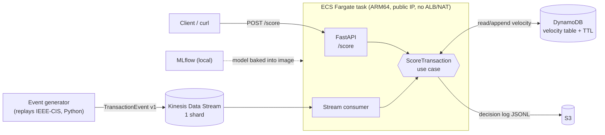

# fraud-scoring

Real-time fraud scoring for card payments: Python · FastAPI · LightGBM · AWS (Kinesis, ECS Fargate, DynamoDB, S3) · CDK.

> **Status: spec phase.** No application code yet. The project is built spec-first:
> nothing gets implemented until its spec is **Approved**. Start with [`specs/`](specs/) and [`docs/adr/`](docs/adr/).

## Problem

A payment authorisation has a few hundred milliseconds to decide: *approve or decline?*
Both kinds of mistake cost money, and the costs are not the same:

- **Missed fraud (false negative):** the full amount is lost to a chargeback, plus fees, often 30–90 days later.
- **False decline (false positive):** a good customer is turned away. The sale is lost and they may not come back.

So the hard part is not just getting a high AUC. It is:

- choosing a decision threshold from **business cost** (in PLN), not from a default of 0.5;
- training on labels that arrive **weeks late** (chargebacks) without leaking the future into the training set;
- computing **velocity features** (e.g. "transactions on this card in the last 10 min") the same way offline and online, with at-least-once event delivery;
- explaining each decline with **reason codes**;
- running a new model in **shadow mode** before it is allowed to decline anyone.

## Goal

An end-to-end, honestly evaluated MVP:

1. Offline: a LightGBM model on the [IEEE-CIS Fraud Detection](docs/adr/0001-dataset.md) dataset with an out-of-time split, simulated label delay, and a cost-optimal threshold. Experiments are tracked in MLflow.
2. Online: `POST /score` → `{score, decision, reasons}` and a Kinesis stream consumer. Both use the same scoring use case and a DynamoDB velocity store.
3. Cloud: an ephemeral AWS environment (`cdk deploy` → demo → `cdk destroy`) that costs **under $5/month**.

## Architecture (MVP sketch)

The detailed design is in [`specs/01-mvp.md`](specs/01-mvp.md).

## Repository map

| Path | What |
|---|---|
| [`specs/00-constitution.md`](specs/00-constitution.md) | Project rules that do not change: stack, quality gates, data rules, spec lifecycle |
| [`specs/01-mvp.md`](specs/01-mvp.md) | MVP spec: scope, ML design, API, acceptance criteria |
| [`docs/adr/`](docs/adr/) | Architecture Decision Records, each mapped to the AWS Well-Architected pillars |

## Roadmap (related projects)

- **payment-service** (Java/Spring): a small payment service that will replace the Python generator as the source of real `TransactionEvent`s, using the same event contract.
- **psp-routing**: smart routing across payment service providers with a multi-armed bandit.

## Disclaimer

This is a portfolio project. It uses no real card data and is not PCI DSS scoped. Card identifiers are pseudonymous tokens.
