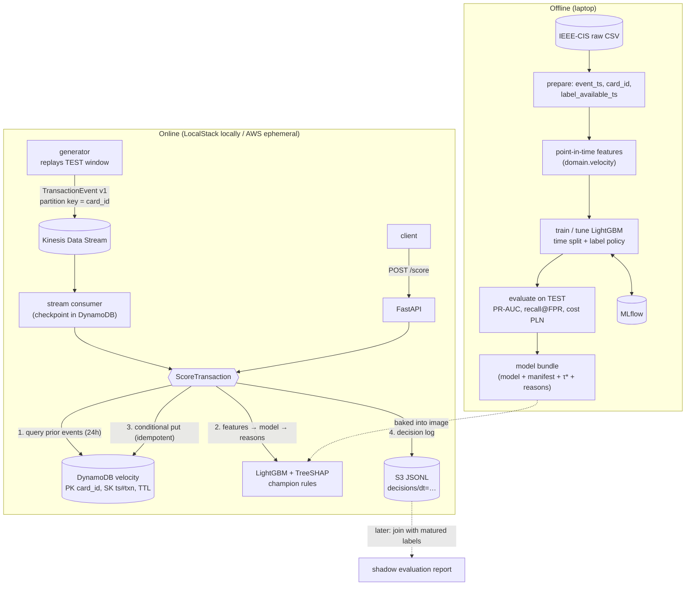

# 01 — MVP: real-time card-payment fraud scoring

| | |
|---|---|
| **Status** | Draft |
| **Owner** | Kacper Celejewski |
| **Created** | 2026-10-18 |
| **Last updated** | 2026-10-18 |
| **Constitution** | [00-constitution.md](00-constitution.md) |
| **Related ADRs** | [0001 dataset](../docs/adr/0001-dataset.md) · [0002 event stream](../docs/adr/0002-event-stream.md) · [0003 velocity store](../docs/adr/0003-velocity-feature-store.md) · [0004 serving](../docs/adr/0004-model-serving.md) · [0005 IaC](../docs/adr/0005-infrastructure-as-code.md) |

## 1. Summary

Score card-payment transactions in near real time and return a fraud **score**, an **approve/decline decision** and up to three **reason codes**. Scoring is available two ways: synchronously (`POST /score`) and from a transaction event stream. A new model runs in **shadow mode**: its decisions are logged and compared, but a simple rules-based champion still makes the effective decision.

The MVP has to show three things: (1) an honestly evaluated model, i.e. out-of-time, delayed-label aware, and judged on business cost; (2) online and offline features that agree; (3) a cloud deployment that fits a **< $5/month** budget.

## 2. Constraints and assumptions

| Constraint | Value | Consequence |
|---|---|---|
| AWS budget | **< $5 / month** | Ephemeral runtime stack. No ALB, NAT, MSK or ElastiCache (constitution §6). |
| Time | **2–4 h / week** | Narrow MVP, delivered in 4 milestones over roughly 3–4 months (§10). Anything not essential goes to §11 *Later*. |
| Event source | Python generator replaying the dataset | The Java/Spring payment service is a separate later project that uses the same event contract (§6.1). |
| Local broker | LocalStack (Kinesis, DynamoDB, S3) | Same boto3 code paths locally and on AWS. |
| Region | `eu-central-1` (Frankfurt) | EU payments context. Prices are slightly higher than `us-east-1`. |

## 3. Goals and non-goals

### Goals (MVP)

- G1. A reproducible offline pipeline: raw IEEE-CIS → point-in-time features → out-of-time split with simulated label delay → LightGBM → evaluation report. All runs tracked in MLflow.
- G2. A cost-based decision threshold in PLN, compared against "approve all" and a rules-based baseline.
- G3. An online scoring service: FastAPI `POST /score` plus a Kinesis consumer, both using one `ScoreTransaction` use case and a DynamoDB velocity store.
- G4. Reason codes from TreeSHAP contributions.
- G5. Shadow mode: the rules champion decides, the model challenger is logged, and both are compared offline.
- G6. One-command local environment (`docker compose up`) and one-command ephemeral AWS environment (`cdk deploy` / `cdk destroy`).

### Non-goals (MVP)

- Real card data, PCI DSS scope, 3-D Secure, issuer/acquirer integration.
- A manual-review queue or case-management UI (decisions are binary in the MVP).
- Automated retraining, drift monitoring, model promotion workflows (§11).
- High availability, multi-shard scaling, multi-region.
- Production-grade API authentication (ingress is IP-restricted instead, see §8).

## 4. ML design

### 4.1 Dataset

**IEEE-CIS Fraud Detection** (Vesta, Kaggle 2019): about 590k labelled card-not-present transactions over roughly 6 months, with a fraud rate of about 3.5%. Only `train_transaction.csv` + `train_identity.csv` are used, because the Kaggle test set has no labels. See [ADR 0001](../docs/adr/0001-dataset.md) for the comparison with PaySim.

- `TransactionDT` (seconds since an unknown reference point) becomes `event_ts` = `2026-01-01T00:00:00Z + TransactionDT`. Only relative time matters.
- `TransactionAmt` (USD, decimal) becomes `amount_minor` (cents, `int`, using round-half-even). Costs are converted to PLN at a configured fixed rate (default `USD_PLN = 4.00`).
- **Card entity:** IEEE-CIS has no card ID. A pseudonymous `card_id` is derived as `hash(card1, addr1, first_seen_day)`, where `first_seen_day = floor(TransactionDT / 86400) − D1`, a common, documented proxy for a card/account. This is a known approximation (ADR 0001).

### 4.2 Features

| Group | Features | Notes |
|---|---|---|
| Transaction | `log1p(amount)`, `ProductCD`, `card4`, `card6`, hour-of-day, day-of-week | From the event itself |
| **Velocity (card)** | `card_txn_count_10m`, `card_txn_count_1h`, `card_txn_count_24h`, `card_amount_sum_1h`, `card_amount_sum_24h`, `seconds_since_prev_card_txn`, `amount_to_card_mean_24h_ratio` | **Point-in-time:** only events of the same `card_id` with `event_ts` in `[t − w, t)`. The current transaction is excluded. |
| Dataset attributes | A selected subset of `C*`, `D*`, `M*`, `V*`, `P_emaildomain`, `DeviceType` | Passed through in the event's `attributes` map. The subset is chosen by an experiment on the training window only. |

Rules:

- Velocity features are implemented **once** in `domain/features/velocity.py`. That function takes "prior events of the card" + "current event" and returns the features. Offline it is fed by a sorted groupby scan; online it is fed by the DynamoDB adapter. A **parity test** checks that both paths produce the same features for the same event sequence (AC-2.4).
- Window edges: `[t − w, t)`, half-open. Events with identical `event_ts` are ordered by `transaction_id`. Property-based tests (`hypothesis`) cover the edge cases.

### 4.3 Delayed labels and the time split

Chargebacks arrive 30–90 days after the transaction, so at any training cutoff the most recent labels are **not yet known**. Counting "no chargeback yet" as "legit" makes recent data look cleaner than it is and biases the model.

**Simulation:** every transaction gets a `label_available_ts`:

- fraud: `event_ts + U(30, 90) days` (seeded, configurable distribution);
- legit: `event_ts + 90 days` (the *maturity window*: a transaction counts as legitimate only after the chargeback window closes).

**Out-of-time split** (proportions are fixed; exact day boundaries are set from the observed `TransactionDT` range at implementation time):

```
day:  0 ──────────── ~100 ──────── ~123 ─────────── ~153 ──────────── ~183
      │    TRAIN      │   VALID     │  label gap      │      TEST       │
      │  (fit)        │ (early stop,│  (30 days, not  │ (out-of-time,   │
      │               │  threshold) │   used)         │  reported once) │
                                                      ▲
                                            simulated deployment date D
```

- The 30-day gap stands for the minimum chargeback delay between the newest usable label and deployment. It is excluded from training and evaluation.
- **Baseline training policy:** use only rows where `label_available_ts ≤ cutoff`. **Experiment E-LBL:** compare it with (a) a naive policy that treats immature rows as legit and (b) a policy that adds immature rows already known to be fraud. Report how each one biases fraud rate and metrics.
- The test set is evaluated **once per candidate model** at the end, never used for selection.

### 4.4 Model

- **LightGBM** binary classifier. Early stopping on VALID PR-AUC. Class imbalance is handled through `scale_pos_weight` *or* no reweighting, chosen by experiment, and the effect on calibration is reported.
- **Baselines** (all on the same TEST set):
  1. *Approve all.*
  2. *Rules champion:* decline if `card_txn_count_10m ≥ N` **or** (`amount ≥ A` and `card_txn_count_1h ≥ M`). `N, A, M` are tuned on VALID by cost.
  3. *LightGBM without velocity features* (ablation that shows what velocity features add).
- Hyper-parameter search is small and budget-bounded (e.g. 30 trials) on TRAIN/VALID only.

### 4.5 Metrics

| Metric | Why |
|---|---|
| **PR-AUC** (average precision), primary ranking metric | ROC-AUC looks flattering at a 3.5% base rate. PR-AUC focuses on the positive class. |
| **Recall @ FPR = 1%** (and 0.5%) | The operating point a fraud team actually controls: "how much fraud do we catch if we decline at most 1% of good traffic?" |
| **Expected cost (PLN)** at the chosen threshold, and savings vs. baselines | The metric the business cares about (§4.6) |
| Amount-weighted recall | Share of fraud **value** caught. Large frauds matter more. |
| Calibration (reliability curve, Brier score) | Needed if the threshold is ever made amount-aware |

### 4.6 Cost-based decision threshold

Cost model (all values configurable, defaults below are **assumptions to be confirmed**, see §12):

| Outcome | Cost (PLN) |
|---|---|
| True positive (fraud declined) | 0 |
| **False negative** (fraud approved) | `amount_pln + chargeback_fee` (default fee 50 PLN, merchant liable in CNP) |
| **False positive** (good customer declined) | `margin_rate × amount_pln + friction_cost` (defaults: 10% lost margin + 10 PLN for churn/support) |
| True negative | 0 |

- **MVP policy:** one global threshold `τ*` = arg min of total expected cost on **VALID**, reported on **TEST**.
- **Experiment E-BAYES (stretch):** an amount-aware Bayes rule, decline if `p · C_FN(a) > (1 − p) · C_FP(a)`, i.e. `p > C_FP(a) / (C_FP(a) + C_FN(a))`. This needs calibrated probabilities (isotonic calibration fitted on a VALID slice that is not used for early stopping).
- The evaluation report includes a **cost-vs-threshold curve** with `τ*` and the rules baseline marked.

### 4.7 Reason codes

- Use LightGBM's native TreeSHAP (`predict(..., pred_contrib=True)`) at serving time, so the `shap` package is not needed in the serving image. The `shap` library is used offline for analysis plots only.
- Take the top 3 features with **positive** contribution to fraud and map them to stable reason codes through a static table in `domain/reasons.py`, e.g.:

| Code | Trigger feature(s) | Message |
|---|---|---|
| `VEL_CARD_10M` | `card_txn_count_10m` | Unusually many transactions on this card in the last 10 minutes |
| `VEL_CARD_AMT_24H` | `card_amount_sum_24h`, `amount_to_card_mean_24h_ratio` | Spend on this card far above its recent pattern |
| `AMT_HIGH` | `log1p(amount)` | Unusually high amount |
| `NEW_CARD_ACTIVITY` | `seconds_since_prev_card_txn` (missing/small) | Little or bursty history for this card |
| `DEVICE_EMAIL_RISK` | `P_emaildomain`, `DeviceType` | Risky email domain / device profile |
| `OTHER_RISK_SIGNALS` | anonymised `C*/D*/V*/M*` | Other risk signals (anonymised in source data) |

Known limitation: IEEE-CIS features are largely anonymised, so many explanations will fall into `OTHER_RISK_SIGNALS`. This is reported honestly. It is not hidden.

### 4.8 Experiment tracking

- MLflow tracking server in docker-compose (SQLite backend, local artefact store).
- Every run logs: git commit, dataset checksum, split boundaries, label policy, feature list, params, all §4.5 metrics, the cost curve plot, the feature-importance plot and the model artefact.
- The chosen model is registered as `fraud-lgbm` and exported (LightGBM text model + feature manifest + reason-code table + threshold) into a versioned bundle `model_bundle/<version>/`.

## 5. Architecture



### 5.1 Scoring flow (`ScoreTransaction` use case)

1. Validate the event (Pydantic `TransactionEvent v1`).
2. Read the card's prior events in `[t − 24h, t)` from the velocity store. Filter by `event_ts` in application code, because DynamoDB TTL deletion is lazy (ADR 0003).
3. Compute features (same domain function as offline), get the model score and TreeSHAP contributions, then produce the champion (rules) decision and the challenger (model) decision.
4. Append the current event to the velocity store with a **conditional put** (`attribute_not_exists`) on `ts#transaction_id`. Kinesis is at-least-once, so a redelivered event is not counted twice. A duplicate is detected and its earlier decision is returned again.
5. Write a decision log record (buffered, flushed as JSONL to S3 every N records or T seconds).

Ordering: the Kinesis partition key is `card_id`, so events of one card are ordered within a shard. Read-before-write per card is therefore consistent in the single-consumer MVP. The synchronous API path can race with the stream path for the same card. This is accepted and documented for the MVP, because demos use one path at a time.

### 5.2 Runtime components

| Component | Local | AWS (ephemeral) |
|---|---|---|
| Event stream | LocalStack Kinesis | Kinesis Data Streams, provisioned, **1 shard** ([ADR 0002](../docs/adr/0002-event-stream.md)) |
| Velocity store + consumer checkpoint | LocalStack DynamoDB | DynamoDB on-demand + TTL ([ADR 0003](../docs/adr/0003-velocity-feature-store.md)) |
| Scoring API + consumer | docker-compose services from one image | **ECS Fargate**: one task, two containers (`api`, `consumer`), ARM64, public subnet + public IP, no ALB/NAT ([ADR 0004](../docs/adr/0004-model-serving.md)) |
| Decision log | LocalStack S3 | S3 (gateway endpoint not needed with public IP) |
| Experiment tracking | MLflow container | n/a (stays local in the MVP) |
| IaC | n/a | AWS CDK (Python): `PersistentStack` (S3, ECR, Budgets) + `RuntimeStack` (Kinesis, DynamoDB, ECS) ([ADR 0005](../docs/adr/0005-infrastructure-as-code.md)) |

The Kinesis consumer is a simple single-shard polling consumer (`GetShardIterator`/`GetRecords`) with the checkpoint stored in DynamoDB. KCL is not used: in Python it needs the Java MultiLangDaemon, and that is too much for one shard. Multi-shard leasing is listed in §11.

## 6. Interfaces

### 6.1 Event contract `TransactionEvent v1`

A dataset-agnostic contract, so the future Java/Spring payment service can produce it unchanged. It will be published as JSON Schema in `contracts/transaction-event.v1.json`.

| Field | Type | Notes |
|---|---|---|
| `schema_version` | `"1"` | |
| `event_id` | UUID | Unique per delivery attempt from the producer |
| `transaction_id` | string | Idempotency key |
| `event_ts` | RFC 3339 UTC | Event time |
| `card_id` | string | Pseudonymous token, **never a PAN** |
| `amount_minor` | int ≥ 0 | Minor units |
| `currency` | ISO 4217 | |
| `merchant_id` | string, optional | |
| `channel` | `"CNP" \| "CP"` | |
| `attributes` | `map[str, str \| float \| int \| null]` | Dataset-specific pass-through features |

### 6.2 `POST /score`

Request: a `TransactionEvent v1` body.

Response `200`:

```json
{
  "transaction_id": "T-2987000",
  "score": 0.873,
  "decision": "DECLINE",
  "mode": "shadow",
  "model_decision": "DECLINE",
  "champion_decision": "APPROVE",
  "reasons": [
    {"code": "VEL_CARD_10M", "feature": "card_txn_count_10m", "contribution": 1.42},
    {"code": "VEL_CARD_AMT_24H", "feature": "card_amount_sum_24h", "contribution": 0.61},
    {"code": "OTHER_RISK_SIGNALS", "feature": "V258", "contribution": 0.33}
  ],
  "model_version": "fraud-lgbm:3",
  "threshold": 0.41
}
```

- `mode = "shadow"` (default): `decision` = `champion_decision`, and the model only advises. `mode = "enforce"`: `decision` = `model_decision`. The mode is set by configuration, not per request.
- `score` is the model's raw probability output, labelled as uncalibrated unless E-BAYES is adopted.
- Errors: `422` invalid payload (Pydantic). If the velocity store is unavailable, the behaviour is open question **Q4** (§12). The proposal is to fall back to the champion decision, mark the response `degraded: true`, and never return `503` for a scoreable payment.
- `GET /health` (liveness) and `GET /ready` (model loaded, store reachable).

### 6.3 Decision log record

`transaction_id, event_ts, scored_at, mode, score, threshold, model_decision, champion_decision, decision, reasons[], model_version, latency_ms`, partitioned in S3 as `decisions/dt=YYYY-MM-DD/`.

## 7. Shadow mode evaluation

- The generator replays the **TEST** window (time-compressed, e.g. 1 simulated day per minute) through the stream.
- A batch job joins the decision log with matured labels (labels whose `label_available_ts` falls before the "evaluation date") and reports champion vs. challenger: expected cost in PLN, recall, decline rate, and agreement matrix.
- **Promotion criterion (documented, applied manually in the MVP):** the challenger's cost is lower than the champion's on matured labels, and its decline rate is within an agreed limit (Q3).

## 8. Non-functional requirements

| Area | Requirement |
|---|---|
| Latency | Server-side `/score` processing p95 < **100 ms** on Fargate 0.5 vCPU, including the DynamoDB round trips (measured from logs). In-process scoring (features + model + reasons) p95 < **10 ms**. |
| Throughput | ≥ 50 events/s through the stream on one shard (well below the shard limit of 1,000 records/s). |
| Security | Security group allows ingress only from `operator_cidr`. Task role is least-privilege. No secrets. Everything in constitution §5. |
| Cost | Runtime stack < **$0.10 per demo hour**. Monthly total < $5. Budgets alarm deployed. |
| Operability | JSON logs to CloudWatch Logs (1-day retention on ephemeral stack). `cdk destroy` leaves no billable runtime resources behind. |

## 9. Acceptance criteria

### M1 — Offline model

- [ ] AC-1.1 `uv run fraud-prepare` builds the prepared dataset from the raw Kaggle files and checks raw-file checksums.
- [ ] AC-1.2 Split boundaries, label gap and label policy are configurable. Tests assert that no TRAIN/VALID row has `event_ts` ≥ the start of the gap, and that no training label has `label_available_ts` > cutoff.
- [ ] AC-1.3 Velocity features pass property-based tests: window edges, identical timestamps, the current event excluded, empty history.
- [ ] AC-1.4 LightGBM and the 3 baselines are evaluated on TEST. The report contains PR-AUC, recall @ FPR 1% / 0.5%, amount-weighted recall, and expected cost in PLN, each run linked to an MLflow run ID.
- [ ] AC-1.5 `τ*` is chosen on VALID by minimum cost, and the cost-vs-threshold curve is saved as an MLflow artefact.
- [ ] AC-1.6 Experiment E-LBL is run and its result is summarised in `docs/results/` (how the naive label policy inflates metrics).
- [ ] AC-1.7 A model bundle is exported (model, feature manifest, threshold, reason-code table, version).

### M2 — Local online scoring

- [ ] AC-2.1 `docker compose up` starts LocalStack (Kinesis, DynamoDB, S3), MLflow, the API and the consumer. A `make demo-local` (or `uv run` task) replays N TEST events.
- [ ] AC-2.2 `POST /score` returns the §6.2 schema, with up to 3 reason codes that each have a positive contribution.
- [ ] AC-2.3 Replaying the same event twice does not change velocity counts (idempotency test against LocalStack).
- [ ] AC-2.4 **Parity test:** for a sample of ≥ 1,000 replayed TEST events, online features equal offline features exactly (integers) or within 1e-9 (floats). Online scores equal offline scores within 1e-6.
- [ ] AC-2.5 Shadow mode: `decision == champion_decision` in every response, and the decision log has both decisions.
- [ ] AC-2.6 Layering rules (`lint-imports`) and the full quality gate (constitution §7) pass.

### M3 — Ephemeral AWS

- [ ] AC-3.1 `cdk synth` passes `cdk-nag` (AwsSolutions). Every suppression has a written reason.
- [ ] AC-3.2 `cdk deploy RuntimeStack` → demo replay → `cdk destroy RuntimeStack` works end to end. After destroy, a check (script or Cost Explorer tags) shows no Kinesis stream, ECS service or public IPv4 address left.
- [ ] AC-3.3 Server-side `/score` p95 latency on Fargate is measured and recorded (target §8).
- [ ] AC-3.4 AWS Budgets alarms ($3 forecast / $5 actual) are deployed by `PersistentStack`.
- [ ] AC-3.5 The cost of one demo session is measured (Cost Explorer, tag `project=fraud-scoring`) and recorded in `docs/results/`.

### M4 — Verification and write-up

- [ ] AC-4.1 The shadow evaluation report (§7) is generated from the decision log.
- [ ] AC-4.2 README "Results" section: metrics table, cost curve, architecture, what did not work, honest limitations.
- [ ] AC-4.3 Spec status → Implemented → Verified, with links to the evidence.

## 10. Milestones (at ~3 h/week)

| Milestone | Scope | Estimate |
|---|---|---|
| M0 | Specs + ADRs approved | 1 week |
| M1 | Offline model (§4) | ~5 weeks |
| M2 | Local online scoring (§5–7, local) | ~4 weeks |
| M3 | Ephemeral AWS | ~3 weeks |
| M4 | Shadow report + write-up | ~1–2 weeks |

## 11. Later (explicitly out of the MVP)

- **Drift monitoring:** PSI/KS on features and the score distribution, decline-rate alarms, label-delay-aware performance tracking.
- **Retraining pipeline in AWS Step Functions:** scheduled data prep → training (Fargate task or SageMaker training job) → evaluation gate → registry → champion/challenger promotion.
- Three-way decision (approve / **review** / decline) with analyst capacity in the cost model.
- Amount-aware Bayes decision policy as the default (if E-BAYES wins).
- Multi-shard consumer with leasing (KCL or Lambda event source mapping) and enhanced fan-out.
- More velocity entities (email domain, device, address), plus graph/link features.
- Minute-bucket counters (atomic `ADD`) instead of per-event items for hot cards.
- API authentication (API Gateway + JWT/Cognito), and CI/CD with GitHub Actions + OIDC to AWS.
- The **Java/Spring payment service** as the event producer (separate repo, same contract).

## 12. Open questions (for approval)

- **Q1.** Cost defaults: chargeback fee 50 PLN, lost margin 10%, friction 10 PLN, `USD_PLN = 4.00`. OK?
- **Q2.** Is recall @ FPR = 1% the right headline operating point, or should it be 0.5%?
- **Q3.** Maximum acceptable model decline rate for promotion (e.g. ≤ 2% of traffic)?
- **Q4.** Velocity store unavailable: fail open (approve, score without velocity), fail closed (decline), or fall back to the champion with whatever features are available? Proposal: **fall back to the champion, flag `degraded=true`, never decline only because of the outage.**
- **Q5.** Bake the model into the container image (proposed: immutable and simple) or load it from S3 at startup? If accepted, this becomes a separate ADR 0006.
